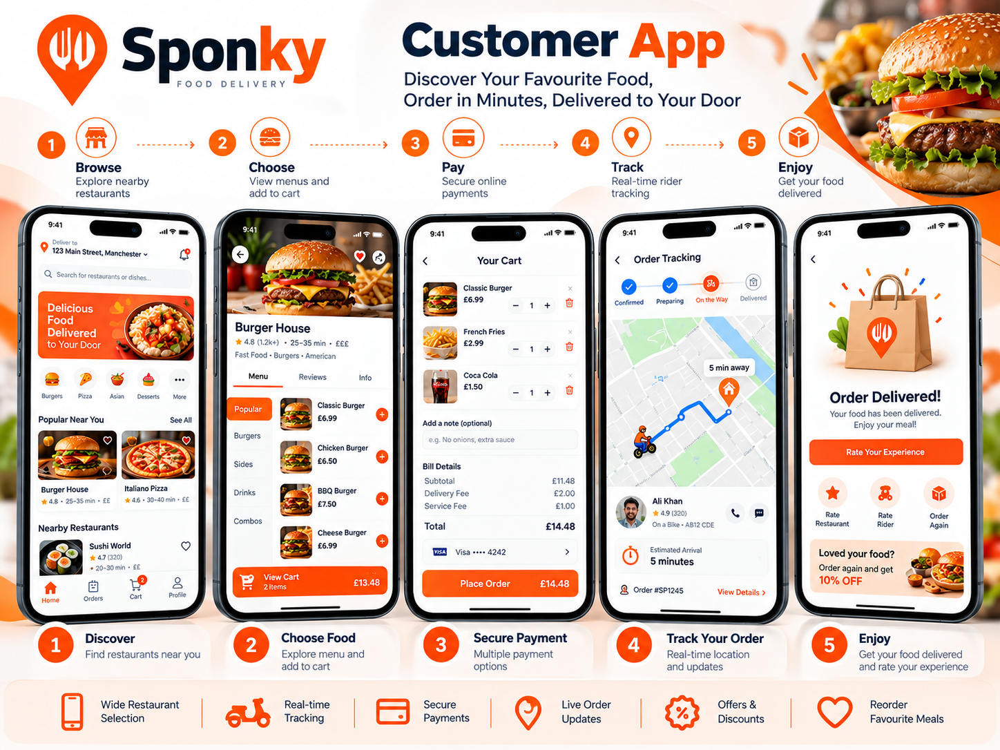
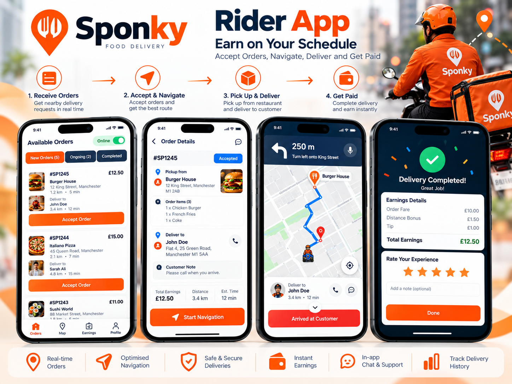
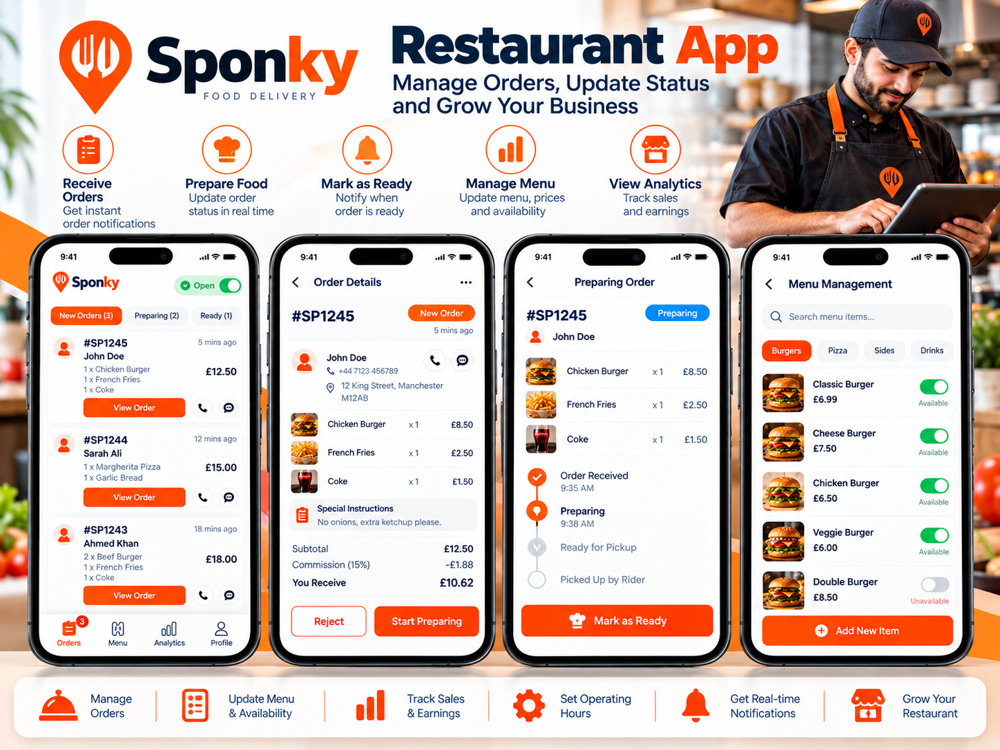

# Sponky: Food Delivery Platform (Flutter)

**A multi-restaurant food delivery platform like Uber Eats: three Flutter apps, two web panels and a website on one Laravel backend.**

Built by [Oriental Tech Solutions](https://github.com/OrientalTechSolutions) · Flutter · iOS & Android

---

## Screenshots

## The need

Customers order from many restaurants, riders deliver, and restaurants and admins run it all. Each group needed its own app or panel, all working on one shared backend.

## What we built

- **Customer app (Flutter):** browse restaurants, menus, cart, checkout and live order tracking
- **Rider app (Flutter):** available orders, accept and pick up, navigation to the customer, delivery status
- **Restaurant app (Flutter):** incoming orders, preparation status, menu and availability management
- **Admin web panel:** restaurants, riders, customers, orders and settings
- **Restaurant web panel:** orders and menu management from the desktop
- **Customer website**
- **Laravel backend** behind every app and panel
- **Google Maps** for locations, routes and delivery tracking

## Tech stack

`Flutter` `Dart` `Laravel` `REST API` `Google Maps` `Push notifications`

## Our role

Product planning, UI implementation, all three Flutter apps, the web panels, backend and API, testing and store release.

---

> 🔒 **Source code is private.** This is a client project and the code belongs to the client. This repository shows the features, screens and technology used.

**Need a delivery, marketplace or on-demand app?** [Hire us on Upwork](https://www.upwork.com/freelancers/attaullahhazarvi)
